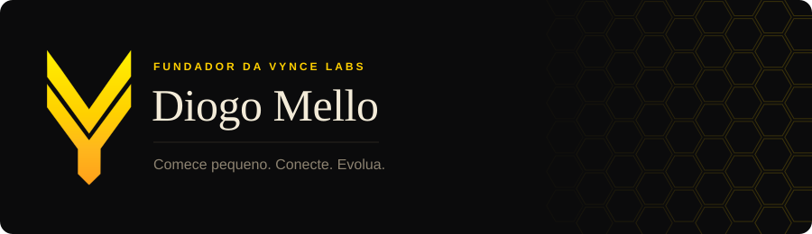

<picture>
  <source media="(prefers-color-scheme: dark)" srcset="assets/banner-escuro.svg">
  <source media="(prefers-color-scheme: light)" srcset="assets/banner-claro.svg">
  
</picture>

 

Sou o Diogo. Fundei a [Vynce Labs](https://vyncelabs.com.br) para fazer software do jeito que eu acredito: entender o problema antes de escolher a tecnologia, começar pelo menor pedaço que já resolve alguma coisa e ir conectando o resto depois.

A Vynce chama quem trabalha com a gente de parceiro, não de cliente. O mascote é uma abelha porque é assim que a coisa funciona por aqui: cada módulo faz o seu trabalho e a colmeia cresce junto.

### Na bancada agora

**Vynce Modas** é o sistema para loja de roupa. Balcão, caixa, relatórios, frete, nota fiscal pelo Bling e atendimento pelo WhatsApp, tudo conversando entre si. Agora estou colocando agentes de IA rodando local para ajudar na gestão.

**Sólon** é o meu trabalho de graduação na Fatec. Um app de gestão financeira pessoal que puxa seu extrato pelo Open Finance, entende as compras parceladas e simula como vai estar o seu mês daqui a pouco.

**Papo de Faculdade** é o site do podcast universitário que leva o mesmo nome. Aconteceu na faculdade, virou papo. Roda inteiro na borda da Cloudflare, com painel próprio para a equipe publicar.

**Vynce Arcade** é o lado mais divertido: jogos feitos para projetor laser, controlados ao vivo, com ranking aparecendo no telão.

### Com o que eu construo

  
  
  
  
  
  
  
  
  
  

### A colmeia

Em vez de cobrinha ou pac-man, aqui cada dia do meu último ano vira um favo. Uma abelha passa por todos os dias em que eu contribuí e enche o favo de mel, mais dourado quanto mais eu fiz naquele dia. O favo do dia mais cheio do ano solta um brilho quando ela chega. Atualiza sozinha todo dia.

<picture>
  <source media="(prefers-color-scheme: dark)" srcset="https://raw.githubusercontent.com/Diogo-Mello/Diogo-Mello/output/colmeia-escura.svg">
  <source media="(prefers-color-scheme: light)" srcset="https://raw.githubusercontent.com/Diogo-Mello/Diogo-Mello/output/colmeia-clara.svg">
  
</picture>

### Onde me achar

  
  
  

Comece pequeno. Conecte. Evolua.
